 

📍 Managua, Nicaragua · 🇪🇸 [Versión en español](./README.md)

## 👋 Who I am

I'm a mathematician and IT consultant with 12+ years of work in QA, cloud/hybrid infrastructure, Business Intelligence, and web development.

I come from the math olympiad world: I won Nicaragua's national olympiad twice and earned honorable mentions at the Ibero-American and Central American olympiads. That's where I learned what still defines my work today: **understand the problem before touching the solution**.

That foundation took me into teaching (Jóvenes Talento Saturday Academy, training for Ministry of Education teachers, Data Analytics for public institutions), and later to a 10-year run directing **Fundación Uno's CODE project**, in alliance with **Harvard CS50x**: a program that trains **940+ students every year** in computer science, where I led functional QA for a team of **73 technical staff** under Harvard University standards.

Today I work as an independent consultant. I rescue production platforms, audit security and performance, design infrastructure, and build data systems for companies that depend on their technology working every day.

## 🛠️ What I do

| Area | In practice |
|:-----|:------------|
| **IT & AI Consulting** | Technology assessments, solution architecture, AI integration into real business operations |
| **QA & Debugging** | Functional testing (UAT), code audits, deep debugging to rescue platforms in production |
| **Infrastructure & Cloud** | Linux/Windows servers, VPS (cPanel/WHM), hybrid on-premise environments, cloud VoIP (3CX + Dinstar), Fortinet, Mikrotik |
| **Data & BI** | Executive web dashboards, SSRS, Excel-to-live-system ETL, KPIs management actually uses |
| **Web development** | Full-stack applications (Next.js/TypeScript, PHP, Node), installable PWAs, portals with custom authentication, WordPress expert |

## 🚀 Recent work

Production systems, designed and built end to end:

- **Change-request management system** — multi-project PWA with 4 roles and push notifications that arrive with the app closed. The Web Push cryptography (RFC 8291 + VAPID ES256) is implemented by hand with native PHP extensions: zero Composer, migrating the app means copying files. `PHP 8 · SQLite/MySQL`
- **Retail business-indicators dashboard** — processes ~5,900-row Excel backups from 58 stores and computes occupancy and rent KPIs. The history lives versioned in a GitHub repo: no database to maintain. `Next.js 14 · TypeScript · Tailwind · Recharts · Vercel`
- **Corporate documentation portals** — JWT + PBKDF2 authentication on Vercel Edge Middleware, per-section access and instant revocation against MySQL. No framework, no npm. `Edge Functions · MySQL · PHP`
- **Executive fleet dashboards** — interactive reports in a single HTML file that management opens without installing anything. `React · Tailwind`
- **[nekupe.com](https://nekupe.com)** — website of Nekupe Sporting Resort (Nandaime, Nicaragua): shared PHP partials architecture, admin panel with drag-and-drop gallery, SEO/GA4, FTPS deployment. `PHP · AngularJS · MySQL · Bluehost`

## 🧭 How I work

- **Minimal dependencies.** Several of my production systems run without Composer, npm, or a framework. Fewer dependencies mean a smaller attack surface and a migration that comes down to copying files from one server to another. This GitHub profile consumes no external service either: the banner, icons, and badges are SVG files that live inside the repository.
- **Security from the first commit.** I use PBKDF2 hashing for passwords, signed JWTs for sessions, sensitive files kept outside the webroot, and input sanitization against XSS. I define it in the project's initial architecture, before writing the business logic.
- **Documentation with every delivery.** Every system I hand over includes its README with the architecture, a migration guide, and a versioned changelog, so someone else can pick up the project without depending on me.
- **AI applied with judgment.** I use AI in the parts of the work where it speeds up concrete results, and I review every line of code that carries my name before signing off on it.

## 🧰 Stack

**Languages & Frontend**

**Backend, data & infrastructure**

 

**Also** · SQL Server (SSRS) · Advanced Excel (Power Query, VBA, macros) · PWA & Web Push · cPanel/WHM · DNS · 3CX · Fortinet · Mikrotik · Claude Code and LLM workflows for development, QA, and data analysis

## 🏅 Honors

- 🥇 Winner, **Nicaraguan National Mathematical Olympiad** (2007 and 2009)
- 🌎 **Honorable Mention** — Ibero-American Mathematical Olympiad (Mexico 2009, Paraguay 2010)
- 🌎 **Honorable Mention** — Central American and Caribbean Mathematical Olympiad (Honduras 2008)
- 🏛️ Organizing committee, 15th Central American and Caribbean Mathematical Olympiad (2013)
- 🎓 Co-founder, technology commission of the **Nicaraguan Mathematical Olympiad**

## 📫 Let's talk

Got a platform to rescue, data that isn't telling you anything, or a project that needs to start right? Write me.

**[contacto@silvioduarte.com](mailto:contacto@silvioduarte.com)** · **[silvioduarte.com](https://silvioduarte.com)** · **[linkedin.com/in/silvioduarte](https://linkedin.com/in/silvioduarte)**

Silvio Duarte · Mathematician · IT & AI Consultant

