 

📍 Managua, Nicaragua · 🇬🇧 [English version](./README.en.md)

## 👋 Quién soy

Soy matemático y consultor de TI con más de 12 años de trabajo en QA, infraestructura cloud/híbrida, Business Intelligence y desarrollo web.

Vengo del mundo de las olimpiadas de matemática: gané dos veces la olimpiada nacional de Nicaragua y obtuve menciones de honor en la Iberoamericana y la Centroamericana. Ahí aprendí lo que hasta hoy define mi trabajo: **entender el problema antes de tocar la solución**.

Esa base me llevó a la docencia (Academia Sabatina de Jóvenes Talento, capacitación a maestros del MINED, Data Analytics para instituciones públicas) y después a dirigir durante 10 años el proyecto **CODE de Fundación Uno**, en alianza con **Harvard CS50x**: un programa que forma a más de **940 estudiantes cada año** en ciencias de la computación, donde lideré el QA funcional de un equipo de **73 técnicos** bajo estándares de Harvard University.

Hoy trabajo como consultor independiente. Rescato plataformas en producción, audito seguridad y rendimiento, diseño infraestructura y construyo sistemas de datos para empresas que dependen de que su tecnología funcione todos los días.

## 🛠️ Qué hago

| Área | En la práctica |
|:-----|:---------------|
| **Consultoría TI & IA** | Diagnóstico tecnológico, arquitectura de soluciones, integración de IA en operaciones reales de negocio |
| **QA & Debugging** | Pruebas funcionales (UAT), auditoría de código, debugging profundo para rescatar plataformas en producción |
| **Infraestructura & Cloud** | Servidores Linux/Windows, VPS (cPanel/WHM), entornos híbridos on-premise, VoIP cloud (3CX + Dinstar), Fortinet, Mikrotik |
| **Data & BI** | Dashboards ejecutivos web, SSRS, ETL de Excel a sistemas vivos, KPIs que la gerencia usa de verdad |
| **Desarrollo web** | Aplicaciones full stack (Next.js/TypeScript, PHP, Node), PWAs instalables, portales con autenticación propia, WordPress experto |

## 🚀 Trabajo reciente

Sistemas en producción, diseñados y construidos de punta a punta:

- **Sistema de gestión de solicitudes de cambio** — PWA multiproyecto con 4 roles y notificaciones push que llegan con la app cerrada. La criptografía Web Push (RFC 8291 + VAPID ES256) está implementada a mano con extensiones nativas de PHP: cero Composer, migrar la app es copiar archivos. `PHP 8 · SQLite/MySQL`
- **Dashboard de indicadores comerciales (retail)** — procesa respaldos de Excel de ~5,900 filas de 58 tiendas y calcula KPIs de ocupación y renta. El histórico vive versionado en un repo de GitHub: sin base de datos que mantener. `Next.js 14 · TypeScript · Tailwind · Recharts · Vercel`
- **Portales de documentación corporativa** — autenticación JWT + PBKDF2 sobre Vercel Edge Middleware, acceso por sección y revocación instantánea contra MySQL. Sin framework y sin npm. `Edge Functions · MySQL · PHP`
- **Dashboards ejecutivos de flota vehicular** — reportes interactivos en un solo archivo HTML que la gerencia abre sin instalar nada. `React · Tailwind`
- **[nekupe.com](https://nekupe.com)** — sitio de Nekupe Sporting Resort (Nandaime, Nicaragua): arquitectura de parciales PHP compartidos, panel de administración con galería drag-and-drop, SEO/GA4, despliegue FTPS. `PHP · AngularJS · MySQL · Bluehost`

## 🧭 Cómo trabajo

- **Dependencias mínimas.** Varios de mis sistemas en producción funcionan sin Composer, sin npm y sin framework. Bajar la cantidad de dependencias reduce la superficie de ataque y hace que migrar el sistema sea prácticamente copiar archivos de un servidor a otro. Este mismo perfil de GitHub no consume ningún servicio externo: el banner, los iconos y los badges son archivos SVG que viven dentro del repositorio.
- **Seguridad desde el primer commit.** Manejo hash PBKDF2 para las contraseñas, JWT firmados para las sesiones, archivos sensibles fuera del webroot y sanitización de entradas contra XSS. Lo defino en la arquitectura inicial del proyecto, antes de escribir la lógica de negocio.
- **Documentación en cada entrega.** Todo sistema que entrego incluye su README con la arquitectura, la guía de migración y un changelog versionado, para que otra persona pueda tomar el proyecto sin depender de mí.
- **IA aplicada con criterio.** Uso IA en las partes del trabajo donde acelera resultados concretos, y reviso a fondo cada línea de código que lleva mi firma antes de darla por buena.

## 🧰 Stack

**Lenguajes & Frontend**

**Backend, datos & infraestructura**

 

**Además** · SQL Server (SSRS) · Excel avanzado (Power Query, VBA, macros) · PWA & Web Push · cPanel/WHM · DNS · 3CX · Fortinet · Mikrotik · Claude Code y flujos de trabajo con LLM en desarrollo, QA y análisis de datos

## 🏅 Reconocimientos

- 🥇 Ganador de la **Olimpiada Nacional de Matemática de Nicaragua** (2007 y 2009)
- 🌎 **Mención de Honor** — Olimpiada Iberoamericana de Matemáticas (México 2009, Paraguay 2010)
- 🌎 **Mención de Honor** — Olimpiada Matemática de Centroamérica y el Caribe (Honduras 2008)
- 🏛️ Comité organizador de la 15.ª Olimpiada Matemática de Centroamérica y el Caribe (2013)
- 🎓 Co-fundador de la comisión de tecnología de la **Olimpiada Matemática Nicaragüense**

## 📫 Hablemos

¿Tenés una plataforma que rescatar, datos que no dicen nada o un proyecto que necesita arrancar bien? Escribime.

**[contacto@silvioduarte.com](mailto:contacto@silvioduarte.com)** · **[silvioduarte.com](https://silvioduarte.com)** · **[linkedin.com/in/silvioduarte](https://linkedin.com/in/silvioduarte)**

Silvio Duarte · Matemático · Consultor de IT y de IA

